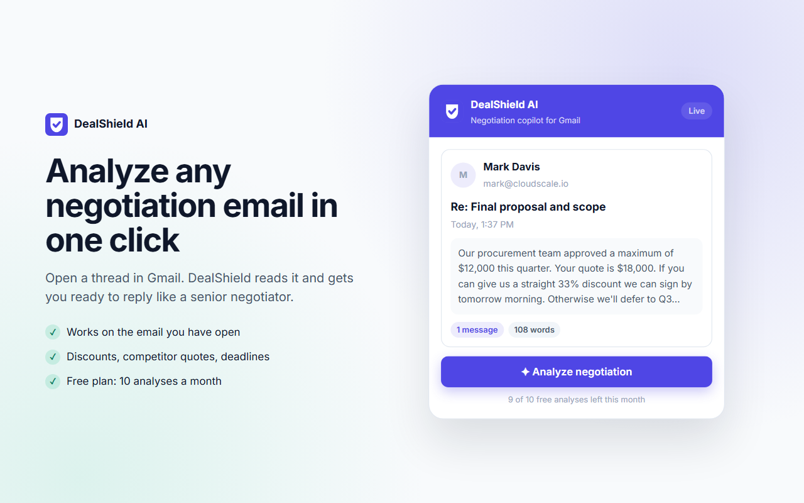
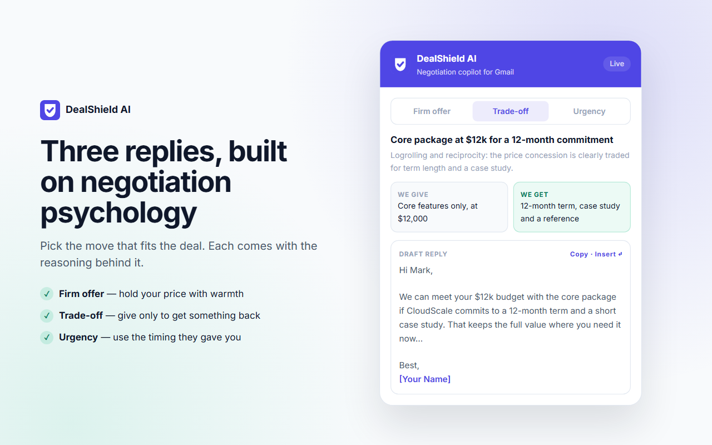
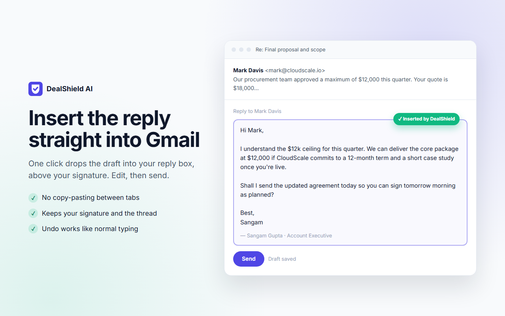
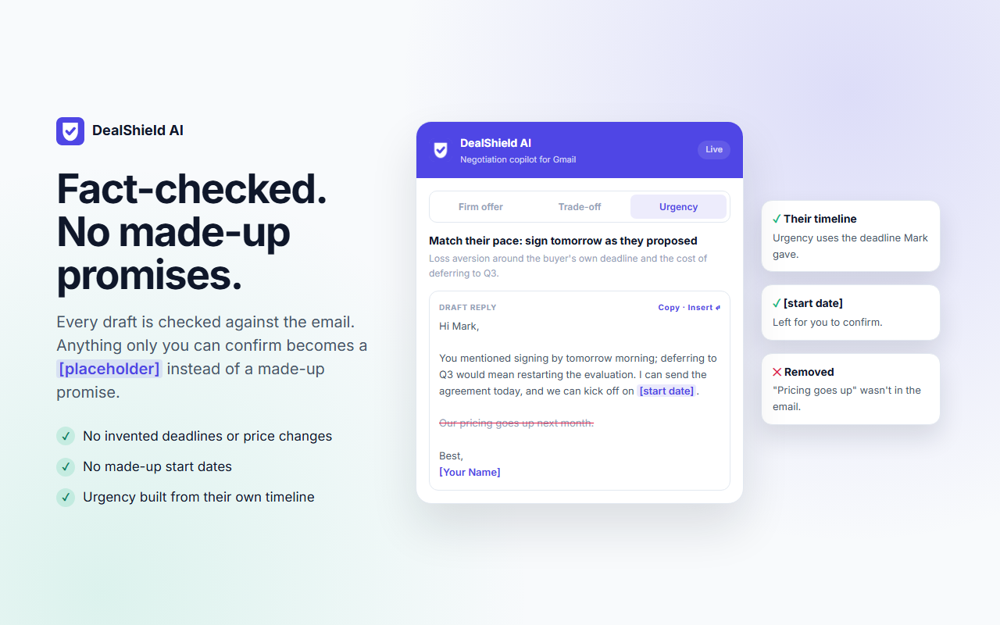

# DealShield AI

**Negotiation copilot for Gmail.** Open a tough email from a prospect, click **Analyze negotiation**, and get three fact-checked reply strategies, ready to insert into Gmail.

**[Install from the Chrome Web Store](https://chromewebstore.google.com/detail/kbpklkipafiimileagddpmbljlmgofia)** · [Website](https://dealshield-site.onrender.com) · [Privacy policy](https://dealshield-site.onrender.com/privacy.html)


## What it does

- **Three strategies per email:** a firm offer that holds your price, a creative trade-off that spells out the give and the get, and an urgency draft built from the timeline the prospect already gave.
- **Fact-checked drafts:** a second AI pass compares every draft with the email and turns invented deadlines, price changes or start dates into `[placeholders]` for you to confirm.
- **Insert into Gmail:** one click puts the draft into the reply box, above your signature.
- **Sidebar and history:** a panel inside Gmail threads, and past analyses you can reopen.
- **Free and Pro plans:** 10 analyses a month free; Pro (₹499/month) is unlimited, billed with Razorpay subscriptions.
- **Privacy first:** nothing leaves the browser until the user agrees to a data notice and clicks Analyze, and the email text is never stored.

| Analyze | Strategies | Insert | Fact-check |
|---|---|---|---|
|  |  |  |  |

## Tech stack

| Part | Built with |
|---|---|
| Extension | Chrome Manifest V3, React 19, Vite, Tailwind CSS, Shadow DOM sidebar |
| Backend | Node.js 22, Express 5, Zod validation, rate limiting |
| AI | Groq (`openai/gpt-oss-120b`) with strict JSON-schema output and a fact-check pass |
| Auth and data | Supabase Auth and Postgres with row-level security |
| Payments | Razorpay subscriptions with signed webhooks |
| Hosting | Render (API and static website) |

`CLAUDE.md` is the source of truth for architecture, conventions and the API contract.

## How it fits together

```
Gmail tab ─ content script reads the open thread
   │
Extension popup / sidebar (React) ── Supabase Auth (email + password)
   │  background worker adds the Supabase JWT
   ▼
Backend (Express) ── auth + Free/Pro quota ── Groq (gpt-oss-120b): strategies, then fact-check
   │                                        └─ Supabase: subscriptions, usage, history
   └─ Razorpay: Pro subscriptions via hosted checkout + webhook
```

## Prerequisites

- Node.js 22+
- A Supabase project (schema in `backend/supabase/migrations/`)
- A Groq API key
- A Razorpay account (optional; billing stays off until its keys are set)

## Local setup

```bash
# Backend
cd backend
cp .env.example .env        # fill in GROQ_API_KEY, SUPABASE_URL, SUPABASE_SERVICE_ROLE_KEY
npm install
npm run dev                 # http://localhost:3000

# Extension
cd ../extension
cp .env.example .env        # fill in VITE_SUPABASE_URL, VITE_SUPABASE_ANON_KEY
npm install
npm run build:local         # talks to localhost:3000; `npm run dev` rebuilds on change
                            # (`npm run build` uses .env.production → the live API)
```

Load the extension: `chrome://extensions` → Developer mode → **Load unpacked** → `extension/dist`. Reload any open Gmail tab.

Apply the database schema by running the SQL files in `backend/supabase/migrations/` in order (Supabase SQL Editor, or `supabase db push`).

## Tests

```bash
cd backend
npm run test:analyze   # health 200, analyze without token 401, real Groq analyze 200
```

`npm run dev:ui` in `extension/` previews the popup in a normal browser tab with sample data.

## Billing (Razorpay)

1. Razorpay Dashboard → Subscriptions → Plans: create the Pro plan (currently ₹499/month, INR). The popup reads the price from this plan. Charging in USD needs International Payments enabled.
2. Settings → API Keys: copy the key id and secret.
3. Settings → Webhooks: add `https://<your-backend>/api/billing/webhook` with the `subscription.*` events and a secret.
4. Put `RAZORPAY_KEY_ID`, `RAZORPAY_KEY_SECRET`, `RAZORPAY_PLAN_ID`, `RAZORPAY_WEBHOOK_SECRET` in `backend/.env` (and in Render).

Use Razorpay test mode keys first. Users upgrade from the popup; their plan switches to Pro when the webhook confirms payment.

## Deploying the backend (Render)

1. Push this repository to GitHub.
2. Render → **New → Blueprint** → select the repo. `render.yaml` defines the service.
3. Enter the secret values Render asks for (Groq, Supabase service role, Razorpay).
4. Note the service URL. The live one is `https://dealshield-ai.onrender.com` (service `dealshield-ai`, created in the dashboard with root directory `backend`, `npm ci`, `npm start`, health check `/api/health`).

The free Render plan sleeps after 15 minutes idle, so the first request afterwards takes about a minute.

## Publishing the extension

1. Create `extension/.env.production` with `VITE_API_URL=https://<your-backend>` plus the Supabase values.
2. `cd extension && npm run package` builds and writes `dealshield-extension-v<version>.zip`. It refuses to package a build that still points at localhost.
3. Upload the zip in the Chrome Web Store Developer Dashboard. Listing copy and permission justifications are in `docs/chrome-web-store.md`; the privacy policy is live at https://dealshield-site.onrender.com/privacy.html (`website/privacy.html`, kept in sync with `docs/privacy-policy.md`).
4. In Supabase → Authentication → URL Configuration, set the Site URL to a page you control, so confirmation emails don't link to localhost.

## Project layout

```
extension/   Chrome extension (React, Vite, Tailwind, Manifest V3)
backend/     Express API, Groq prompts, Supabase migrations, Razorpay billing
docs/        Privacy policy and Chrome Web Store listing
website/     Static marketing site + privacy page (Render static site dealshield-site)
store-assets/ Chrome Web Store screenshots and promo tiles (HTML frames → PNG)
render.yaml  Render deployment blueprint
```

## License

Copyright © 2026 Sangam Gupta. All rights reserved. The source is public so it can be read; it may not be copied, modified, redistributed or used without written permission. See [LICENSE](LICENSE). To use DealShield, [install it from the Chrome Web Store](https://chromewebstore.google.com/detail/kbpklkipafiimileagddpmbljlmgofia).

Contact: contact@sangamgupta.in
